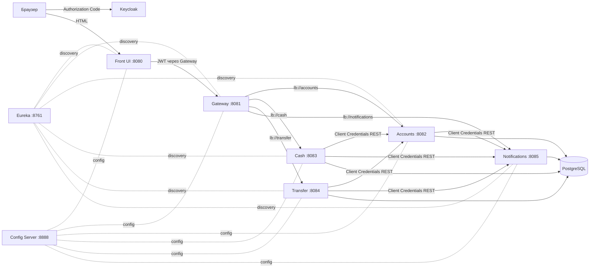

# Bank App — микросервисное приложение «Банк»

Учебное микросервисное приложение на Java 21 / Spring Boot 3.5 / Spring Cloud 2025.
Пользователь входит во фронт через Keycloak (Authorization Code Flow), редактирует профиль,
пополняет и снимает деньги, переводит средства другому клиенту.

## Архитектура



### Модули

| Модуль | Назначение | Порт |
|---|---|---:|
| `discovery-server` | Eureka Server, Service Discovery | 8761 |
| `config-server` | Spring Cloud Config Server, native-профиль | 8888 |
| `gateway` | Spring Cloud Gateway, проверка JWT, проброс токена, Circuit Breaker | 8081 |
| `front` | Spring MVC + Thymeleaf, OAuth2 Login (Authorization Code) | 8080 |
| `accounts` | аккаунты, баланс, профиль; Database per Service | 8082 |
| `cash` | пополнение и снятие наличных | 8083 |
| `transfer` | переводы между счетами | 8084 |
| `notifications` | уведомления (лог + БД) | 8085 |

### Реализованные паттерны

- **API Gateway** — `gateway`, маршрутизация по `lb://`.
- **Service Discovery** — Eureka, все сервисы регистрируются в нём.
- **Externalized / Distributed Config** — Spring Cloud Config Server; общие настройки в `config-repo/application.yml`.
- **Database per Service** — отдельные БД `accounts_db`, `cash_db`, `transfer_db`, `notifications_db` в одном PostgreSQL.
- **Access Token / OAuth 2.0** — Authorization Code Flow для пользователя, Client Credentials для межсервисных вызовов.
- **Circuit Breaker** — Resilience4j в клиентах и в Gateway.
- **Transactional Outbox** — события уведомлений сохраняются вместе с бизнес-операцией и публикуются планировщиком.
- **Contract Testing** — Spring Cloud Contract (producer-контракты Accounts и Notifications, сгенерированные тесты).
- **UI Composition** — `front` собирает данные Accounts в одну HTML-страницу.
- **REST + LoadBalancer** — межсервисные вызовы через `RestClient` и Eureka.
- **Идемпотентность** — `Idempotency-Key`/`requestId`, уникальные ключи операций.
- **Saga + Reconciliation** — состояния операций `PENDING/SUCCESS/FAILED` и повторная обработка.

### Надёжность денежных операций

- Все суммы валидируются по точности (`NUMERIC(19,2)`, не более 2 знаков после запятой).
- В PostgreSQL действуют ограничения `balance >= 0`, `amount > 0`, корректный масштаб сумм.
- Списание/пополнение Accounts выполняются под `SELECT ... FOR UPDATE`.
- Перевод блокирует оба счёта одной выборкой в детерминированном порядке и выполняется
  в изоляции `SERIALIZABLE` с повтором при serialization failure/deadlock.
- Каждая денежная операция имеет `request_id`; повторный запрос возвращает сохранённый
  результат и не меняет баланс повторно.
- Cash и Transfer создают локальную операцию в состоянии `PENDING`, вызывают Accounts
  вне локальной транзакции, затем атомарно фиксируют `SUCCESS` и outbox-события.
- Планировщик повторяет `PENDING`-операции с тем же `request_id`.
- Outbox захватывает события через `FOR UPDATE SKIP LOCKED`, отправляет их вне транзакции
  и поддерживает восстановление зависших событий.
- Notifications дедуплицирует события по `event_id`.
- Фронт передаёт `Idempotency-Key` и блокирует повторную отправку формы.

## Требования

- JDK 21
- Docker и Docker Compose
- Maven не обязателен: используется Maven Wrapper (`./mvnw`)

## Быстрый запуск в Docker

```bash
docker compose up -d --build
```

После старта:

- Front UI: http://localhost:8080
- Keycloak: http://localhost:8180 (admin / admin)
- Eureka: http://localhost:8761
- Config Server: http://localhost:8888
- Gateway: http://localhost:8081

Тестовые пользователи Keycloak (пароль `password`):

| Логин | ФИО |
|---|---|
| `ivanov` | Иванов Иван |
| `petrov` | Петров Пётр |
| `sidorov` | Сидоров Сидор |

Остановить:

```bash
docker compose down
```

Удалить данные:

```bash
docker compose down -v
```

## Локальный запуск

1. Поднять PostgreSQL и Keycloak:

```bash
docker compose up -d postgres keycloak
```

2. Собрать проект:

```bash
./mvnw clean package
```

3. Запустить в отдельных терминалах:

```bash
java -jar discovery-server/target/discovery-server-1.0.0-SNAPSHOT.jar
java -jar config-server/target/config-server-1.0.0-SNAPSHOT.jar
java -jar notifications/target/notifications-1.0.0-SNAPSHOT.jar
java -jar accounts/target/accounts-1.0.0-SNAPSHOT.jar
java -jar cash/target/cash-1.0.0-SNAPSHOT.jar
java -jar transfer/target/transfer-1.0.0-SNAPSHOT.jar
java -jar gateway/target/gateway-1.0.0-SNAPSHOT.jar
java -jar front/target/front-1.0.0-SNAPSHOT.jar
```

Сервисы читают общие настройки из Config Server. При локальном запуске используются
значения по умолчанию из `application.yml` и переменных окружения.

Для запуска всех JAR одной командой после сборки:

```bash
cp .env.example .env
./scripts/run-local.sh
```

Пример переменных:

```bash
export DB_HOST=localhost
export KEYCLOAK_ISSUER=http://localhost:8180/realms/bank
export KEYCLOAK_JWK_SET_URI=http://localhost:8180/realms/bank/protocol/openid-connect/certs
export KEYCLOAK_TOKEN_URI=http://localhost:8180/realms/bank/protocol/openid-connect/token
```

## OAuth 2.0 и права доступа

Realm: `bank`.

| Клиент | Flow | Scopes |
|---|---|---|
| `front` | Authorization Code | `accounts.read`, `accounts.write`, `cash.write`, `transfer.write` |
| `accounts-service` | Client Credentials | `service`, `notifications.write` |
| `cash-service` | Client Credentials | `service`, `accounts.read`, `accounts.write`, `notifications.write` |
| `transfer-service` | Client Credentials | `service`, `accounts.read`, `accounts.transfer`, `notifications.write` |

- Пользовательский JWT содержит `preferred_username` и scopes, необходимые фронту.
- Внутренние `/internal/**` методы Accounts требуют `SCOPE_service` и соответствующий scope.
- Пользователь не имеет `notifications.write` и не может обращаться к внутренним методам.
- Gateway проверяет JWT и пробрасывает `Authorization: Bearer ...` в сервисы.
- Сервисы получают service token через Client Credentials Flow.

## REST API

### Accounts

| Метод | Путь | Доступ |
|---|---|---|
| GET | `/accounts/me` | пользователь, `accounts.read` |
| PUT | `/accounts/me` | пользователь, `accounts.write` |
| GET | `/accounts/others` | пользователь, `accounts.read` |
| GET | `/internal/accounts/{login}` | сервис, `service` + accounts scope |
| POST | `/internal/accounts/{login}/deposit` | сервис, `service` + `accounts.write` |
| POST | `/internal/accounts/{login}/withdraw` | сервис, `service` + `accounts.write` |
| POST | `/internal/accounts/transfer` | сервис, `service` + `accounts.transfer` |

### Cash

Для операций обязателен заголовок `Idempotency-Key: <UUID>`.

| Метод | Путь | Доступ |
|---|---|---|
| POST | `/cash/deposit` | пользователь, `cash.write` |
| POST | `/cash/withdraw` | пользователь, `cash.write` |

### Transfer

Для операции обязателен заголовок `Idempotency-Key: <UUID>`.

| Метод | Путь | Доступ |
|---|---|---|
| POST | `/transfer` | пользователь, `transfer.write` |

### Notifications

| Метод | Путь | Доступ |
|---|---|---|
| POST | `/notifications` | сервис, `notifications.write` |

Через Gateway фронт обращается по путям `/api/accounts/**`, `/api/cash/**`,
`/api/transfer/**`, `/api/notifications/**`.

## Валидация

- имя и фамилия не пустые;
- дата рождения не в будущем, возраст не меньше 18 лет;
- сумма операции больше нуля;
- при снятии/переводе проверяется достаточность средств;
- перевод самому себе запрещён.

## Тесты

```bash
./mvnw clean verify
```

Покрытие:

- unit-тесты сервисов (`AccountServiceTest`, `CashServiceTest`, `TransferServiceTest`, `NotificationServiceTest`);
- MVC-тесты контроллеров с проверкой security;
- интеграционные тесты через `@SpringBootTest` + H2 (PostgreSQL-режим);
- тесты на Testcontainers PostgreSQL: конкурентные переводы, идемпотентность операции,
  отсутствие отрицательного баланса и потери денег;
- контрактные тесты Spring Cloud Contract:
  - Accounts: `src/test/resources/contracts/accounts/*.groovy`;
  - Notifications: `src/test/resources/contracts/notifications/*.groovy`;
- тесты Gateway fallback;
- тесты Front MVC/Thymeleaf.

## База данных

PostgreSQL, один инстанс, отдельные БД и пользователи:

| Сервис | БД | Пользователь |
|---|---|---|
| accounts | `accounts_db` | `accounts_user` |
| cash | `cash_db` | `cash_user` |
| transfer | `transfer_db` | `transfer_user` |
| notifications | `notifications_db` | `notifications_user` |

Миграции — Flyway, лежат в `src/main/resources/db/migration`.
Начальные аккаунты создаются миграцией `V2__seed_accounts.sql`.

## Конфигурация

`config-server/src/main/resources/config-repo/`:

- `application.yml` — общие настройки Eureka, OAuth2 Resource Server, Resilience4j, логирования;
- `<service>.yml` — настройки конкретного сервиса: порт, БД, OAuth2 Client.

Секреты в dev-окружении заданы значениями по умолчанию. Для production используйте
переменные окружения и не храните секреты в репозитории.

## Docker

- у каждого модуля есть multi-stage `Dockerfile` (JDK 21 → JRE 21);
- `docker-compose.yml` поднимает PostgreSQL, Keycloak, Eureka, Config Server и все сервисы;
- каждый сервис опубликован на своём порту (Single Service per Host);
- данные PostgreSQL хранятся в named volume `postgres-data`.

## Полезные команды

```bash
# сборка без тестов
./mvnw clean package -DskipTests

# только тесты
./mvnw test

# только контрактные тесты Accounts
./mvnw -pl accounts test

# логи контейнера
docker compose logs -f accounts

# перезапуск одного сервиса
docker compose up -d --build accounts
```

## Ограничения учебного проекта

По условию задания не реализуются: репликация и Load Balancer, Kafka/JMS,
ELK, распределённая трассировка, Kubernetes, CI/CD, полноценный мониторинг.
